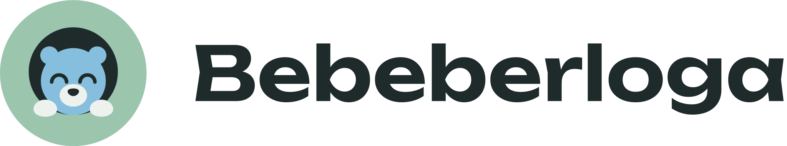

# Bebeberloga: бренд и правила дизайна

## Суть

**Bebeberloga — своя берлога для своих людей.** Это открытая платформа для голосовых и текстовых сообществ: её можно поставить на своём сервере, а разговоры защищены сквозным шифрованием.

- **Обещание:** здесь уютно, и чужие разговоры никто не подслушивает.
- **Слоган:** Своя берлога для своих. / Your own den for your own people.
- **Фраза о приватности:** Что сказано в берлоге, остаётся в берлоге.
- **Написание:** Bebeberloga, по-русски Бебеберлога.
- **Аудитория для старта:** русскоязычные геймеры и сторонники open source. Для остальных поясняем: «berloga is Russian for a bear's den».

## Голос

Бренд говорит как друг, который уже поставил чайник: тепло, слегка дурашливо, но в технических вопросах точно. Сначала говорим об уюте и компании, а шифрование объясняем как свойство, которое это делает возможным.

| Ситуация | Как звучит |
|---|---|
| Приглашение | Заходи к нам в берлогу. |
| Пустой канал | Тут пока тихо. Разбуди кого-нибудь. |
| Никого нет в сети | Все спят. Берлога подождёт. |
| Ошибка соединения | Медведь споткнулся. Пробуем ещё раз. |
| Шифрование | Разговор зашифрован на ваших устройствах, сервер не может его прочитать. |

**Термины в интерфейсе — привычные для чатов сообществ:** сервер, канал, голосовой канал, участники, приглашение, стрим, саундборд. Слово «берлога» остаётся только в маркетинге и шутливых подписях. Название бренда всегда пишем полностью: Bebeberloga.

## Логотип

Символ — довольный медвежонок, выглядывающий из круглого входа в берлогу. Глаза всегда дугой вверх.

- **Поле вокруг:** не меньше половины высоты символа.
- **Минимальный размер:** логотип от 160 px в ширину, символ от 48 px. Ещё меньше используем фавикон.
- **Фон:** версия `for-dark` для тёмного фона, `for-light` для светлого.
- **Нельзя:** менять цвета и пропорции, поворачивать, добавлять тени и обводки, ставить на пёстрый фон.

## Цвета

Основная тема тёмная, светлая пока не описана. Первые четыре цвета фирменные, остальные четыре нужны только в интерфейсе.

| Цвет | HEX | Для чего | Контраст с Хвоей |
|---|---|---|---|
| Хвоя | `#1E2B2A` | Основной фон, текст на светлых заливках | — |
| Шалфей | `#9CC5AE` | Главные кнопки, индикатор говорящего | 7.7:1 |
| Иней | `#86BEDD` | Медвежонок, ссылки, второй акцент | 7.3:1 |
| Туман | `#EEF2EE` | Основной текст, светлый фон | 12.9:1 |
| Панель | `#2B3B39` | Панели и карточки | — |
| Лишайник | `#A9B8B2` | Второстепенный текст | 7.1:1 |
| Брусника | `#E8A0A0` | Ошибки и удаление | 6.9:1 |
| Морошка | `#E8C987` | Предупреждения: «Подключение…», «отошёл», устройство не подтверждено | 9.2:1 |

На панели все цвета текста тоже проходят порог WCAG AA 4.5:1: контраст от 5.6:1. На заливках Шалфеем, Инеем и Брусникой текст всегда цвета Хвои.

## Шрифты

| Шрифт | Начертание | Для чего | Размер |
|---|---|---|---|
| Unbounded | 600 | Логотип и короткие заголовки | 28 px |
| Nunito | 700 | Подзаголовки и кнопки | 20 и 16 px |
| Nunito | 400 | Основной текст | 16 px, подписи 14 px |
| JetBrains Mono | 400 | Коды безопасности, ключ восстановления, клавиши, код в сообщениях | 12–16 px |

Все три шрифта поддерживают кириллицу и распространяются по лицензии SIL OFL 1.1. Пакеты: `@fontsource/unbounded`, `@fontsource/nunito`, `@fontsource/jetbrains-mono`.

## Интерфейс

Значения для кода лежат в [`brand/tokens.css`](brand/tokens.css).

- **Скругления:** 8 px у мелких элементов, 12 px у кнопок и полей, 20 px у карточек.
- **Отступы:** кратны 4 px: 4, 8, 12, 16, 24, 32.
- **Кнопки:** главная залита Шалфеем, второстепенная с контуром, ссылка цвета Инея.
- **Говорящий участник:** кольцо цвета Шалфея вокруг аватара.
- **Глубина:** интерфейс плоский, мягкая тень только у всплывающих окон.
- **Иллюстрации:** те же плоские формы и цвета, медвежонок всегда дружелюбный.

## Границы

- **Медведь — милый персонаж, а не символ страны:** без ушанок, балалаек, триколора и грозного оскала.
- **Не обещаем лишнего:** пишем «сквозное шифрование», а не «полная анонимность». Обещания о приватности должны совпадать с тем, что делает код.
- **Не копируем другие мессенджеры:** ни их фирменные цвета (в том числе сине-фиолетовый), ни символы, ни формулировки. Это важно и для clean-room-подхода.
- **Без образа хакера:** ни неона, ни замков, ни тёмных капюшонов.

## Файлы

Все файлы лежат в [`brand/`](brand/).

| Файл | Для чего |
|---|---|
| `bebeberloga-icon.svg`, `bebeberloga-icon-1024.png` | Иконка приложения |
| `bebeberloga-logo-for-dark.svg`, `bebeberloga-logo-for-light.svg` | Логотип |
| `bebeberloga-wordmark-for-dark.svg`, `bebeberloga-wordmark-for-light.svg` | Только надпись |
| `bebeberloga-symbol.svg`, `bebeberloga-symbol-1024.png` | Символ без фона |
| `favicon.svg`, `favicon.ico` | Вкладка браузера и мелкие размеры |
| `tokens.css` | Цвета, шрифты, скругления и отступы для кода |

## Что ещё не сделано

- [ ] Проверить Bebeberloga в TMview и знаки «Берлога» в Роспатенте по классам 9, 38, 42.
- [ ] Показать название юристу по интеллектуальной собственности.
- [ ] Купить bebeberloga.com, если проверки пройдены.
- [ ] Сказать название 5–10 людям в голосовом чате и проверить, найдут ли они его.
- [ ] Нарисовать иллюстрации для пустых состояний и макеты экранов, когда дойдёт до интерфейса.
