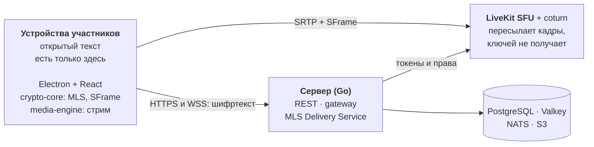

<p align="center">
  
</p>

<h1 align="center">Bebeberloga</h1>

<p align="center">
  <b>Своя берлога для своих: self-hosted платформа для голосовых и текстовых сообществ со сквозным шифрованием.</b>
</p>

<p align="center">
  Текстовые и голосовые каналы, личные сообщения, видео, стрим экрана, окна или приложения
  со звуком только этого приложения и soundboard. Сервер ставится на своё железо, а всё общение,
  включая стрим, шифруется на устройствах участников (MLS, RFC 9420): сервер хранит и передаёт
  только шифртекст.<br>
  <i>Что сказано в берлоге, остаётся в берлоге.</i>
</p>

<p align="center">
  
  
  
  <a href="LICENSING.md"></a>
  <br>
  <a href="ROADMAP.md"></a>
  <a href="https://github.com/nihestver/bebeberloga/actions/workflows/ci.yml"></a>
  <a href="REUSE.toml"></a>
  <a href="CONTRIBUTING.md"></a>
  <a href="docs/cleanroom/POLICY.md"></a>
</p>

<p align="center">
  <a href="docs/spec/ARCHITECTURE.md"><b>Архитектура</b></a> ·
  <a href="ROADMAP.md">Дорожная карта</a> ·
  <a href="docs/README.md">Вся документация</a> ·
  <a href="SECURITY.md">Безопасность</a>
</p>

> [!NOTE]
> **Bebeberloga в фазе 0: фундамент и спайки.** Спецификация, архитектурные решения и протокол
> написаны, первые спайки приняты, а кода приложения и собранных версий ещё нет. README описывает
> цель версии 1.0; что сделано на самом деле, показывает раздел [«Что готово сегодня»](#что-готово-сегодня).

<p align="center">
  <a href="#почему-bebeberloga">Почему Bebeberloga</a> ·
  <a href="#что-готово-сегодня">Что готово сегодня</a> ·
  <a href="#быстрый-старт">Быстрый старт</a> ·
  <a href="#для-агентов-claude-code">Для агентов</a> ·
  <a href="#архитектура">Архитектура</a> ·
  <a href="#дорожная-карта">Дорожная карта</a> ·
  <a href="#загрузки">Загрузки</a> ·
  <a href="#документация">Документация</a> ·
  <a href="#участие">Участие</a> ·
  <a href="#лицензии-и-авторство">Лицензии и авторство</a>
</p>

## Почему Bebeberloga

- **Своё.** Сервер — один бинарник на Go: Docker Compose для небольшого инстанса, Helm-чарт для
  большого. Данные сообщества хранит тот, кто его держит.
- **Шифруется всё.** Личные сообщения, каналы, файлы, голос, камера и стрим шифруются на
  устройствах участников: MLS (RFC 9420, OpenMLS) управляет группами и ключами, SFrame шифрует
  медиакадры. Сервер и SFU получают только шифртекст.
- **Без режима «попроще».** Переключателя «без E2EE» и отката на транспортное шифрование нет.
  Когда не хватает ресурсов, снижается качество стрима, а не защита.
- **Стрим со звуком приложения.** Экран, окно или отдельное приложение, 720p30–1080p60, стерео
  48 кГц, задержка меньше секунды. В режиме окна в стрим попадает звук только этого приложения.
- **История для своих.** Новые участники и новые устройства видят историю канала, а сервер не
  получает ни ключей истории, ни текста ([ADR-0015](docs/adr/0015-history-visible-to-members.md)).
- **Открыто.** Сервер под AGPL-3.0, клиенты под GPL-3.0, библиотеки под Apache-2.0. Clean room:
  реализация пишется только по собственной спецификации, открытым RFC и документации open-source
  библиотек, а каждый ассет — свой или под свободной лицензией.
- **Сделано с агентами.** Код пишет Claude Code по промптам, а правила, проверки и независимое
  ревью для агента лежат прямо в репозитории.

## Что готово сегодня

| Область | Состояние |
|---|---|
| **Спецификация** | Функции v1.0 с приоритетами (38 M, 17 S, 21 C), 10 пользовательских потоков, 11 экранов с каталогом компонентов и горячими клавишами, модель прав, глоссарий с запретным списком — [`docs/spec/`](docs/spec/README.md) |
| **Решения** | 21 ADR: E2EE на MLS и SFrame, сервер на Go, оболочка Electron, Rust media-engine, лицензии, минимальные версии ОС, история для новых участников — [`docs/adr/`](docs/adr/README.md) |
| **Протокол** | Protobuf-схемы `bebeberloga.v1`, WebSocket-шлюз, REST (OpenAPI 3.0.3), формат сообщений (B1); криптографический дизайн `CRYPTO.md` и контракт MLS Delivery Service (B2) — [`docs/protocol/`](docs/protocol/README.md) |
| **Спайки** | S1: OpenMLS через napi-rs и uniffi (Node, Electron, Swift, Kotlin). S4: MLS Delivery Service на Go с замерами до 4 000 входов. Впереди S2, S3, S5 и S6: E2EE звонка, захват в Electron, звук приложения, E2EE-стрим |
| **Сервер** | Пакеты и контракты определены; код начнётся с промпта B4 |
| **crypto-core, media-engine** | Решения приняты по итогам спайков; код — промпты B3 и B12 |
| **Клиенты** | Экраны описаны, базовые дизайн-токены лежат в [`brand/tokens.css`](brand/tokens.css); код начнётся с B8 и B9 |
| **Процесс** | CI: clean-room фильтр, REUSE, реестр ассетов, shellcheck, ссылки, Go, Rust, web и proto по затронутым каталогам. Git-хуки: Conventional Commits и DCO. Claude Code: скиллы, субагенты-ревьюеры, hooks |

Подробно по каждому промпту — таблица статусов в [`docs/prompts/README.md`](docs/prompts/README.md),
коротко и с числами — [`ROADMAP.md`](ROADMAP.md).

## Быстрый старт

Кода приложения пока нет, поэтому запускаются проверки и спайки:

```sh
git clone https://github.com/nihestver/bebeberloga
cd bebeberloga
mise install        # Go, Rust, Node, pnpm, golangci-lint и buf — версии из mise.toml
lefthook install    # git-хуки: clean room, форматирование, Conventional Commits, DCO
just check          # линтеры и тесты; рецепты модулей, которых ещё нет, пишут «skip»
```

Инструменты для macOS ставятся одной командой из [`docs/dev/WORKFLOW.md`](docs/dev/WORKFLOW.md#инструменты-на-macos).
Спайки запускаются из своих каталогов, например `cd spikes/01-openmls-ffi && just test`; команды и
результаты — в их `REPORT.md`.

Когда появятся сервер (B4) и Compose-файлы (B17), здесь будет запуск своего инстанса.

## Для агентов: Claude Code

Bebeberloga с первого дня разрабатывается вместе с ИИ-агентом: Claude Code выполняет промпты
контура реализации, а репозиторий держит для него источники правды, ограждения и ревью.

```text
/next                                  # прогресс по промптам и что можно запускать сейчас
/prompt B04                            # зависимости → ветка → план (стоп) → код с тестами → STATUS.md → ревью
/review-cleanroom server/internal/mls  # независимое ревью модуля на заимствования
/pr                                    # коммиты по Conventional Commits с DCO и PR по шаблону
```

| Что | Где | Зачем |
|---|---|---|
| Context pack | [`CLAUDE.md`](CLAUDE.md); для других агентов — [`AGENTS.md`](AGENTS.md) | Источники правды, clean room, инварианты E2EE, порядок работы |
| Промпты | [`docs/prompts/`](docs/prompts/README.md) | Один промпт — один модуль, одна ветка и один PR |
| Субагенты | [`.claude/agents/`](.claude/agents) | `cleanroom-reviewer`, `security-reviewer`, `spec-analyst` |
| Hooks | [`.claude/hooks/`](.claude/hooks) | Не дают записать слова из запретного списка, форматируют файлы |
| Права | [`.claude/settings.json`](.claude/settings.json) | `ssh` и `git push` — только с подтверждения; merge PR и push в `main` запрещены; секреты и рабочий план аналитиков закрыты |

Состояние длинной задачи хранится в `STATUS.md` модуля, а не в памяти сессии. Как устроен
рабочий цикл — [`docs/dev/WORKFLOW.md`](docs/dev/WORKFLOW.md).

## Архитектура



| Слой | Компонент | Каталог | Задача | Лицензия |
|---|---|---|---|---|
| Контракты | Protobuf, OpenAPI | `proto/`, `docs/protocol/` | Единственный источник моделей для Go, TypeScript, Kotlin и Swift; REST и gateway | Apache-2.0 |
| Криптография | crypto-core (Rust) | `crypto-core/` | MLS, ключи устройств, файлов, SFrame и истории; FFI через napi-rs, uniffi и wasm-bindgen | Apache-2.0 |
| Медиа | media-engine (Rust) | `media-engine/` | Захват экрана, окна и звука приложения, аппаратное кодирование, публикация стрима | Apache-2.0 |
| Сервер | Модульный монолит на Go | `server/` | `identity`, `community`, `messaging`, `mls`, `gateway`, `media`, `files`, `push`, `admin` | AGPL-3.0-or-later |
| Инфраструктура | LiveKit, coturn, PostgreSQL 16, Valkey 8, NATS JetStream, S3 | `deploy/` | Пересылка зашифрованных кадров, метаданные и шифртекст, присутствие, шина событий, зашифрованные файлы | AGPL-3.0-or-later (конфигурация) |
| Клиенты | React + TypeScript, Electron | `clients/web/`, `clients/desktop/` | Общий интерфейс и desktop-сборки для Windows, macOS и Linux | GPL-3.0-or-later с исключением для магазинов |
| После 1.0 | Android, iOS, Bot SDK | `clients/android/`, `clients/ios/`, `sdk/` | Нативные мобильные клиенты, боты и webhooks | GPL-3.0 / Apache-2.0 |

<details>
<summary>Планируемая структура репозитория</summary>

```text
bebeberloga/
├── docs/            # спецификация, ADR, протокол, clean room, промпты
├── proto/           # Protobuf-схемы (общие для всех)
├── crypto-core/     # Rust: MLS, ключи, файлы, SFrame-ключи, ключи истории; uniffi/napi/wasm
├── media-engine/    # Rust: захват экрана/окна/звука, аппаратное кодирование, публикация стрима
├── server/          # Go: cmd/, internal/{identity,community,messaging,mls,gateway,media,files,push,admin}
├── clients/
│   ├── web/         # React + TS (используется и в desktop)
│   ├── desktop/     # Electron-оболочка, сборки
│   ├── android/     # Kotlin + Compose (после 1.0)
│   └── ios/         # Swift + SwiftUI (после 1.0)
├── sdk/             # Bot SDK: Go и TypeScript (после 1.0)
├── design/          # токены, иконки, Penpot-экспорт, Storybook
├── deploy/          # docker-compose, helm
├── spikes/          # одноразовые эксперименты фазы 0 с отчётами
└── tools/           # скрипты, кодогенерация, lint-конфиги
```

</details>

`just check` запускает clean-room фильтр, REUSE-линт, проверку реестра ассетов, shellcheck,
линтер OpenAPI, а также линтеры и тесты Go, Rust, web и proto; CI вызывает те же рецепты.
Подробности E2EE-дизайна, модели угроз и компромиссов — в
[`docs/spec/ARCHITECTURE.md`](docs/spec/ARCHITECTURE.md) и [`docs/protocol/CRYPTO.md`](docs/protocol/CRYPTO.md).

## Дорожная карта

Bebeberloga в **фазе 0**. Каждая фаза закрывается воротами — проверяемым результатом:

| Фаза | Что входит | Ворота |
|---|---|---|
| **0 — фундамент** | Спецификация, протокол, криптодизайн, спайки S1–S6, дизайн-система, деплой тест-сервера | Спецификация и спайки приняты, E2EE-стрим измерен, деплой на тест-сервер работает |
| **1 — ядро** | crypto-core; сервер: identity, community, MLS DS, messaging, gateway; клиент: вход, устройства, ЛС | E2EE-сообщения между двумя устройствами в канале |
| **2 — голос и стрим** | Звонки, камера, soundboard, media-engine, стрим в клиенте | Стрим 1080p60 с задержкой < 1 с и звуком приложения на трёх ОС |
| **3 — сообщества** | Серверы, каналы, роли и права в клиенте | Все M-функции сообществ закрыты |
| **4 — beta** | Админ-CLI, тест-план, ревью безопасности | Публичная beta |
| **5 — 1.0** | Внешний аудит, Helm-чарт, релизы, документация | Аудит закрыт, релиз 1.0 |

Числа, ближайшие шаги и журнал изменений — в [`ROADMAP.md`](ROADMAP.md). Домен проекта —
`bebeberloga.org`; тест-сервер `test.bebeberloga.org` начнёт получать `main` из CI после B17 ч. 1.

## Загрузки

Собранных версий пока нет. Релизы появятся в [GitHub Releases](https://github.com/nihestver/bebeberloga/releases)
вместе с `SHA256SUMS`, SBOM и подписями cosign; сборки клиентов будут воспроизводимыми (B17 ч. 2).

| Платформа | Минимум | Уровень | Форматы (план) |
|---|---|---|---|
| Windows | 10 21H2 (сборка 19044) и 11 | 1 — блокирует релиз | NSIS, MSIX |
| macOS | 13 Ventura, Apple Silicon и Intel | 1 — блокирует релиз | DMG |
| Linux | Debian 12+, Ubuntu 22.10+ с PipeWire 0.3.62+ | 2 — не блокирует релиз | deb, AppImage, Flatpak |
| Сервер | Linux и Docker | — | Бинарник `bebeberloga-server`, образ в GHCR, Docker Compose, Helm-чарт |

Почему именно эти минимумы — [ADR-0009](docs/adr/0009-platform-minimums.md). Android и iOS — после 1.0
([ADR-0010](docs/adr/0010-mobile-after-1-0.md)).

## Документация

| Документ | Что в нём |
|---|---|
| [`docs/spec/ARCHITECTURE.md`](docs/spec/ARCHITECTURE.md) | Архитектура: E2EE на MLS и SFrame, компоненты сервера, модель данных, стек, стрим, компромиссы E2EE |
| [`docs/adr/`](docs/adr/README.md) | Принятые архитектурные решения (ADR) |
| [`docs/cleanroom/`](docs/cleanroom/POLICY.md) | Политика clean room, журнал, чеклист ревью |
| [`docs/spec/`](docs/spec/README.md) | Функциональная спецификация: глоссарий, инвентарь функций, права, потоки, экраны |
| [`docs/protocol/`](docs/protocol/README.md) | Протокол: gateway, REST, MLS-профиль, формат сообщений |
| [`docs/prompts/`](docs/prompts/README.md) | Промпты для Claude Code: порядок запуска, статусы, шаблон |
| [`docs/dev/WORKFLOW.md`](docs/dev/WORKFLOW.md) | Как разрабатывать: VSCodium и Claude Code, инструменты, локальная среда, тест-сервер, CI/CD |
| [`docs/README.md`](docs/README.md) | Карта всей документации |
| [`ROADMAP.md`](ROADMAP.md) | Стадия, главные числа, ближайшие шаги, журнал изменений |
| [`BRAND.md`](BRAND.md) | Бренд: голос, логотип, палитра, шрифты; файлы — в `brand/` |
| [`LICENSING.md`](LICENSING.md) | Схема лицензий по компонентам и разрешённые лицензии зависимостей |

## Участие

- Код пишется только по спецификации в `docs/spec/` ([политика clean room](docs/cleanroom/POLICY.md)):
  код, ассеты и тексты сторонних продуктов не используются.
- Коммиты — по Conventional Commits с подписью DCO (`git commit -s`); CLA не нужен, авторские права
  остаются у авторов.
- Каждый новый ассет — иконка, изображение, шрифт или звук — записывается в
  [`ATTRIBUTION.md`](ATTRIBUTION.md) в том же коммите.
- Об уязвимостях сообщайте приватно, по [`SECURITY.md`](SECURITY.md), а не в публичных issue.

Порядок работы и чеклист PR — в [`CONTRIBUTING.md`](CONTRIBUTING.md).

## Лицензии и авторство

Copyright © 2026 участники Bebeberloga (Bebeberloga contributors). Компоненты распространяются под
разными свободными лицензиями ([ADR-0003](docs/adr/0003-licenses.md)):

| Компонент | Лицензия |
|---|---|
| Сервер, `deploy/`, сквозные тесты | [AGPL-3.0-or-later](LICENSE) |
| Клиенты | [GPL-3.0-or-later](clients/LICENSE) с [исключением для магазинов приложений](clients/LICENSE-EXCEPTION) |
| crypto-core, media-engine, proto, SDK, design, tools | [Apache-2.0](LICENSES/Apache-2.0.txt) |
| Документация | [CC BY-SA 4.0](LICENSES/CC-BY-SA-4.0.txt) |

У каждого файла есть SPDX-идентификатор ([`REUSE.toml`](REUSE.toml), проверка `reuse lint` в CI);
полная схема и разрешённые лицензии зависимостей — в [`LICENSING.md`](LICENSING.md), обязательные
уведомления — в [`NOTICE`](NOTICE).

Каждый файл-ассет — иконка, изображение, шрифт, звук — записан с автором, источником и лицензией в
[`ATTRIBUTION.md`](ATTRIBUTION.md). Сторонние ассеты допускаются только под свободными лицензиями,
ассетов сторонних мессенджеров в репозитории нет.

Название Bebeberloga, логотип, символ, иконка и надпись в [`brand/`](brand/) — фирменные знаки проекта:
свободные лицензии на них не распространяются. Их можно использовать без изменений, чтобы рассказать
о Bebeberloga или сослаться на него, на условиях
[`LICENSES/LicenseRef-Bebeberloga-Brand.txt`](LICENSES/LicenseRef-Bebeberloga-Brand.txt).
Форки и изменённые версии используют своё название и свои знаки.

<p align="center">
  <br>
  <sub>Сделано участниками Bebeberloga. Своя берлога для своих.</sub>
</p>
