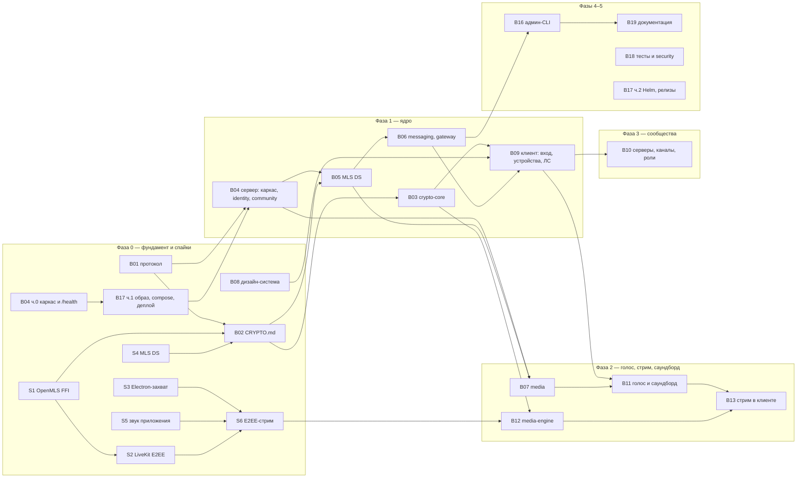

# Промпты для разработки

Работа разбита на промпты двух контуров (`docs/cleanroom/POLICY.md`): **A — аналитика** пишет спецификацию в `docs/spec/`, **B — реализация** (Claude Code) работает только по `docs/spec/`, `docs/adr/`, `docs/protocol/`, `docs/prompts/`, `docs/dev/WORKFLOW.md`, `BRAND.md`, `brand/tokens.css`, `CLAUDE.md` и отчётам спайков `spikes/*/REPORT.md`. `docs/PLAN.md` — рабочий документ контура A; контур B его не читает (архитектура — в [`docs/spec/ARCHITECTURE.md`](../spec/ARCHITECTURE.md) с той же нумерацией разделов).

Каждый промпт — отдельный файл. Запуск в Claude Code: **`/prompt <номер>`** (например `/prompt B01`, `/prompt S1`). Прогресс и следующий шаг: **`/next`**. Коммит и PR: **`/pr`**. Один промпт = одна ветка = один PR.

## Порядок запуска

**Параллельные дорожки** (каждая — отдельный git worktree и отдельная сессия Claude Code):
- Фаза 0: `B01 → B02` · `S1 → S2` · `S4` · `S3` · `S5` (нужно железо) · `B08` · `B04 ч.0 → B17 ч.1` (каркас сервера с `/health`, затем образ, compose и деплой).
- Фаза 1: `B03` · `B04 → B05 → B06` · `B09` (после B03, B06, B08).
- Фаза 2: `B07` · `B12` · затем `B11 → B13`.

**Ворота фаз** (из плана): фаза 0 — спецификация и спайки приняты, E2EE-стрим измерен, деплой на тест-сервер работает; фаза 1 — E2EE-сообщения между двумя устройствами в канале; фаза 2 — стрим 1080p60 < 1 с со звуком приложения на трёх ОС; фаза 3 — все M-функции разделов 3.3–3.4 закрыты; фаза 4 — публичная beta; фаза 5 — аудит закрыт, релиз 1.0.

## Статус

Обновляется скиллом `/prompt` (в конце работы) и вручную после merge. Значения: «не начат», «в работе», «готово (PR #N)», «после 1.0».

| № | Промпт | Файл | Фаза | Зависит от | Статус |
|---|---|---|---|---|---|
| A1 | Инвентарь функций | `docs/spec/FEATURES.md` | 0 | — | готово (черновик) |
| A2 | Пользовательские потоки | `docs/spec/FLOWS/` | 0 | A1 | готово (черновик 1) |
| A3 | Экраны и компоненты | `docs/spec/SCREENS/` | 0 | A2 | готово (черновик 1–2) |
| A4 | Права и роли | `docs/spec/PERMISSIONS.md` | 0 | A1 | готово (черновик 1) |
| A5 | Глоссарий | `docs/spec/GLOSSARY.md` | 0 | — | готово (черновик 1) |
| S1 | Спайк: OpenMLS через FFI | [`S1-openmls-ffi.md`](S1-openmls-ffi.md) | 0 | — | не начат |
| S2 | Спайк: E2EE звонка в LiveKit | [`S2-livekit-e2ee.md`](S2-livekit-e2ee.md) | 0 | S1 | не начат |
| S3 | Спайк: захват в Electron | [`S3-electron-capture.md`](S3-electron-capture.md) | 0 | — | не начат |
| S4 | Спайк: MLS Delivery Service | [`S4-mls-ds.md`](S4-mls-ds.md) | 0 | — | не начат |
| S5 | Спайк: звук приложения | [`S5-app-audio.md`](S5-app-audio.md) | 0 | — | не начат |
| S6 | Спайк: E2EE-стрим 1080p60 | [`S6-e2ee-stream.md`](S6-e2ee-stream.md) | 0 | S2, S3, S5 | не начат |
| B1 | Протокол: Protobuf, gateway, REST | [`B01-protocol.md`](B01-protocol.md) | 0 | A1–A5 | готово (PR #3) |
| B2 | Криптографический дизайн | [`B02-crypto-design.md`](B02-crypto-design.md) | 0 | B1 (S1, S4 желательно) | не начат |
| B3 | Crypto-core (Rust) | [`B03-crypto-core.md`](B03-crypto-core.md) | 1 | B2 | не начат |
| B4 | Сервер: каркас, identity, community | [`B04-server-core.md`](B04-server-core.md) | 0 (ч.0), 1 | ч.0 — нет; остальное — B1, B17 ч.1 | не начат |
| B5 | Сервер: MLS Delivery Service | [`B05-server-mls.md`](B05-server-mls.md) | 1 | B2, B4 | не начат |
| B6 | Сервер: messaging, gateway, files, push | [`B06-server-messaging.md`](B06-server-messaging.md) | 1 | B4, B5 | не начат |
| B7 | Сервер: media, звонки, саундборд | [`B07-server-media.md`](B07-server-media.md) | 2 | B4, B5 | не начат |
| B8 | Дизайн-система | [`B08-design-system.md`](B08-design-system.md) | 0–1 | A3 | не начат |
| B9 | Клиент: каркас, вход, устройства, ЛС | [`B09-client-shell-dm.md`](B09-client-shell-dm.md) | 1 | B1, B3, B6, B8 | не начат |
| B10 | Клиент: серверы, каналы, роли | [`B10-communities.md`](B10-communities.md) | 3 | B4, B6, B9 | не начат |
| B11 | Клиент: голос, камера, саундборд | [`B11-voice-soundboard.md`](B11-voice-soundboard.md) | 2 | B7, B9 | не начат |
| B12 | media-engine | [`B12-media-engine.md`](B12-media-engine.md) | 2 | B3, B7, S5, S6 | не начат |
| B13 | Клиент: стрим | [`B13-stream-ui.md`](B13-stream-ui.md) | 2 | B11, B12 | не начат |
| B14 | Android-клиент | — | после 1.0 | B1, B3, B8 | после 1.0 |
| B15 | iOS-клиент | — | после 1.0 | B14 | после 1.0 |
| B16 | Админ-CLI и конфигурация | [`B16-admin.md`](B16-admin.md) | 4 | B4, B6 | не начат |
| B17 | DevOps: образ, Compose, релизы | [`B17-devops.md`](B17-devops.md) | 0 (ч.1), 5 (ч.2) | B4 ч.0 (для ч.1) | не начат |
| B18 | Тест-план и security review | [`B18-test-security.md`](B18-test-security.md) | 2–5 | все | не начат |
| B19 | Документация | [`B19-docs.md`](B19-docs.md) | 5 | B16, B17 | не начат |
| B20 | Bot SDK и webhook-мост | — | после 1.0 | B1, B3 | после 1.0 |

## Как запускать промпт

1. В VSCodium открой панель Claude Code (или `claude` в терминале) в корне репозитория; `/next` покажет, что можно запускать.
2. `/prompt B01` (для промпта из частей — `/prompt B04 ч.0`) — Claude Code проверит зависимости, создаст ветку, прочитает входные файлы и **покажет план до кода**. Одобри или поправь план.
3. Реализация идёт с `just lint` и `just test`; вопросы к спецификации — в `docs/spec/OPEN-QUESTIONS.md` (на них отвечает контур A в отдельном чате).
4. В конце — `STATUS.md` модуля, ревью субагентами `cleanroom-reviewer` (и `security-reviewer` для криптографии и медиа), затем `/pr`.
5. Новый промпт — новая сессия (`/clear`). Параллельные дорожки — в отдельных worktree: `git worktree add ../bb-<дорожка> -b feat/<промпт>`.

Если промпта нет файлом (B14, B15, B20) — `TEMPLATE-B.md` описывает, как его составить.

## Правила декомпозиции

- Один промпт = один модуль с проверяемым выходом; не «сделай сервер», а «реализуй пакет `mls` по `docs/protocol/CRYPTO.md` с тестами T1–T9».
- Сначала контракты (B1, B2, B8), потом реализации — так параллельные промпты не расходятся.
- Каждый промпт заканчивается обновлением ADR/документации; следующий промпт получает актуальные файлы, а не пересказ.
- Для длинных задач — цепочка промптов с явной передачей состояния: `STATUS.md` в каталоге модуля (что сделано, что сломано, что дальше).
- Ревью-промпт после каждого модуля: отдельный агент проверяет соответствие спецификации, лицензии и отсутствие заимствований (чеклист из `docs/cleanroom/`).
